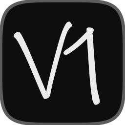

<p align="center">
  
</p>

<h1 align="center">V1</h1>

A native YouTube Music client written in Rust. The interface is drawn by
[Dream](https://github.com/barusoup/dream), a Rust rendering engine. Catalogue and search come from
YouTube Music's InnerTube API, and audio is decoded with FFmpeg. There is no WebView or browser engine.

Lyrics are synced line by line from Boidu (the Better Lyrics API), with
[LRCLIB](https://lrclib.net) as a fallback.

## Requirements

- Stable Rust (validated with Rust 1.96.1; the workspace includes Rust 2024 crates and current dependency versions)
- **Windows / Linux**: A GPU with Vulkan 1.3
- **macOS**: Apple Silicon (`arm64`, macOS 13.0+ with Metal). Older Intel Macs are not supported.
- To run from source: `ffmpeg` and `ffprobe` on `PATH` (e.g. `brew install ffmpeg` on macOS), or set `DREAM_FFMPEG` and `DREAM_FFPROBE`.
  The Windows installer includes them.

## Install

On Windows, download `V1-Setup-<version>.exe` from the [Releases](https://github.com/barusoup/V1/releases) page.
The installer includes FFmpeg and ffprobe. V1 checks for a newer Windows release every time it starts and installs it before the window opens.

On macOS, open the `.dmg` from Releases and drag `V1.app` to Applications. The app bundle includes
FFmpeg and ffprobe. Automatic updates are currently Windows only.

Only one copy runs at a time. While a self-update replaces the app, launches made before the updated
copy starts exit silently, so the new instance opens cleanly.

## Running

```
cargo run -p v1-app --release
```

To package `V1.app` and a `.dmg` for macOS Apple Silicon (`aarch64-apple-darwin`), see the
[macOS packaging and validation instructions](docs/macos-packaging.md):

```
./installer/build-macos.sh
```

## License

V1 is free software licensed under the [GNU Affero General Public License v3.0](LICENSE), with
additional attribution terms in the same file. You can use, modify and share it, including as the
basis of a fork. Forks must remain open source, credit V1 and Barusoup, and not use the "V1" name
or icon for their own product.

## Credits

- **Dream Engine** and **Dream Media Handler** by Hunter Lehr ([Barusoup](https://github.com/barusoup)),
  vendored in `vendor/`. `vendor/dream-media` carries local changes, described in
  [its README](vendor/dream-media/README-v1.md).
- Fonts and icons are listed in [NOTICE](NOTICE). Rust dependencies and their licenses are listed
  in [THIRD-PARTY-LICENSES.md](THIRD-PARTY-LICENSES.md).

V1 is not affiliated with or endorsed by YouTube or Google.
